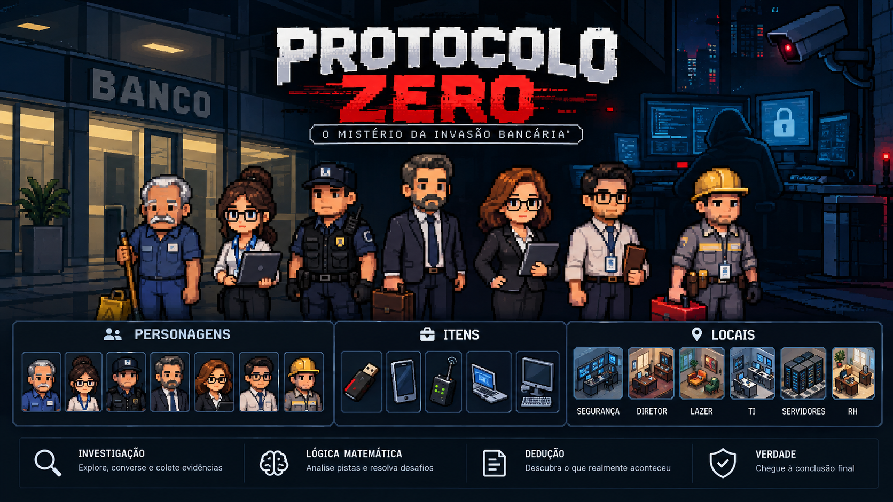

# Protocolo Zero — O Mistério da Invasão Bancária

Jogo local de investigação top-down, feito apenas com Python e Pygame para a disciplina de Resolução de Problemas com Lógica Matemática. Salas ilustradas com imagens locais, sem web ou banco de dados.

## Iniciar o jogo

Na pasta do projeto, abra o terminal do PowerShell e execute:

```powershell
.\.venv\Scripts\python.exe main.py 
ou 
./.venv/bin/python main.py
```

Se o ambiente Python já estiver ativado, use `python main.py`. Na primeira execução, crie o ambiente e instale as dependências seguindo a seção [Executar no VS Code](#executar-no-vs-code).

## Referência visual do projeto



Referência para a identidade visual, os personagens e os ambientes. As seis salas utilizam as ilustrações fornecidas, exibidas no cenário e no mapa (M). Os sete personagens possuem miniaturas no cenário e retratos maiores nos diálogos. Os cinco equipamentos possuem imagens no cenário e na inspeção; as evidências correspondentes também mostram essas imagens no inventário. O investigador controlável e os registros sem arte própria continuam representados por formas geométricas.

As imagens dos personagens são estáticas, exibidas inteiras, com seus fundos originais e sem distorção. A borda azul identifica uma conversa ainda não consultada; a borda verde indica que o personagem já foi ouvido. Se uma imagem estiver ausente ou inválida, o personagem permanece acessível por um marcador circular e pelo diálogo textual.

As imagens isométricas são ilustrações dos ambientes: a movimentação permanece top-down, com portas e colisões delimitadas pelas paredes do mapa. Os móveis desenhados nas imagens são decorativos. As artes são exibidas inteiras e proporcionalmente, sem alterar os pontos de interação.

## Executar no VS Code

Abra esta pasta no VS Code. Use Python 3.10 ou superior e execute no terminal:

```powershell
python -m venv .venv
.venv\Scripts\python -m pip install -r requirements.txt
.venv\Scripts\python main.py
```

Ou, com seu ambiente Python já selecionado/ativado:

```powershell
python -m pip install -r requirements.txt
python main.py
```

No VS Code, selecione `.venv` em **Python: Select Interpreter**. Uma sessão gráfica local é necessária para jogar. Sem Pygame, a entrada mostra o comando de instalação em vez de um traceback.

## Controles e progressão

### Histórias sorteadas

Cada **nova investigação** sorteia uma de quatro histórias, com a mesma chance para cada uma. O sorteio pode repetir um caso. Retomar ou carregar mantém a história e a revisão narrativa da partida; salvamentos anteriores preservam as histórias antigas, e arquivos sem identificador de caso usam o final original. Depoimentos, habilidades, laudos, cronologia, inferências e reconstrução acompanham a história escolhida. Ainda é necessário reunir oito pistas e resolver oito desafios.

**Spoilers — soluções possíveis:**

| História | Pessoa | Método | Equipamento | Evento inicial |
| --- | --- | --- | --- | --- |
| O link na sala de lazer | Seu Antônio | Link malicioso | Celular conectado ao Wi-Fi | 20h35 |
| O apagamento planejado | Jonas | Sabotagem de registros | Pendrive | 20h30 |
| A porta deixada aberta | Márcia | Falha na rede interna | Computador interno | 20h45 |
| O transmissor clandestino | Carlos | Dispositivo transmissor | Dispositivo transmissor | 20h20 |

**1. O link na sala de lazer — Seu Antônio**

Às **20h35**, Seu Antônio abre um link malicioso no **celular conectado ao Wi-Fi** durante sua pausa. O evento compromete credenciais, posteriormente usadas por criminosos externos para acessar o banco. Ele desencadeia o incidente **sem intenção**, não sendo o autor deliberado do ataque. O histórico do navegador e o laudo pericial estabelecem o vínculo entre o clique e a captura das credenciais.

**2. O apagamento planejado — Jonas**

Às **20h30**, Jonas usa o **pendrive** para apagar registros e suas cópias, tentando impedir uma auditoria. Ele alega que estava fazendo manutenção, mas o roteiro recuperado e a execução assinada comprovam **sabotagem deliberada**. Bianca havia usado o mesmo pendrive às 20h20, em um teste autorizado e inofensivo; a rotina destrutiva foi adicionada depois. O alerta detecta a perda de integridade dos registros, sem roubo de credenciais.

**3. A porta deixada aberta — Márcia**

Às **20h45**, Márcia tenta corrigir o acesso aos relatórios pelo **computador interno** e aplica um perfil antigo de permissões. A configuração desativa a exigência de autenticação, permitindo que terceiros consultem os documentos expostos. Foi uma **falha de configuração acidental**, não uma sabotagem. O registro de alterações e o histórico de suporte corroboram sua tentativa de corrigir o problema. Não houve link malicioso nem captura de credenciais.

**4. O transmissor clandestino — Carlos**

Às **20h20**, Carlos instala e ativa um **dispositivo transmissor** nos servidores para enviar documentos confidenciais a um receptor externo. Ele afirma que o aparelho era um medidor elétrico, mas a configuração recuperada e os pacotes assinados comprovam **extração deliberada de dados**. Sua ordem de serviço não autorizava essa instalação. O aparelho só é encontrado às **21h15**; esse horário não corresponde ao início do envio. Neste caso, Modus Tollens exclui o notebook, enquanto a perícia comprova o uso do transmissor.

Em todos os finais, **21h07 é o horário do alerta, não o início do incidente**. Apenas o primeiro caso envolve captura de credenciais. As três histórias adicionais são ficção do jogo; os laudos da partida prevalecem sobre as descrições do caso original nas seções abaixo.

### Como jogar

A investigação começa em um painel inspirado em murais de detetive, com interface escura, destaques em ciano, fichas fotográficas e ligações verificáveis. Clique em **Explorar banco** para controlar o investigador e use **J** para retornar ao mural.

- **Catálogo à esquerda:** consulte as sete pessoas, cinco equipamentos, seis locais e as pistas já coletadas. Use Anterior/Próxima quando houver mais fichas.
- **Abrir ficha:** leia características, habilidades e informações disponíveis. Depoimentos e laudos permanecem bloqueados até serem obtidos na exploração.
- **Fixar no mural:** adicione a ficha selecionada; arraste-a para organizar. Retirar do mural ou o botão direito remove apenas a ficha visual, sem apagar evidências.
- **Ligar fichas:** ative e clique em duas fichas para abrir a análise da relação. Escolha o tipo, a evidência e a justificativa lógica. Clique numa linha ou ligue as mesmas fichas para revisar; a opção Retirar ligação a remove.
- **Rótulos das ligações:** as linhas exibem **Confirma**, **Confirma horário**, **Contradiz** ou **Usou**, junto do estado da justificativa. Clique na linha ou no rótulo para abrir as premissas, a conclusão, a regra e a fonte; use **Consultar evidência** para reler o laudo. **Usou** exige uma ligação entre pessoa e equipamento com registro de uso, não apenas descoberta ou presença. Nas histórias de Jonas e Carlos, as explicações falsas podem ser contraditas após ouvir o depoimento e obter a perícia: escolha a afirmação de confronto, P e P → ¬Q, conclusão ¬Q e Modus Ponens. Editar a justificativa volta a deixá-la pendente; os rótulos e as justificativas acompanham o salvamento.
- **Organizar / Limpar ligações:** reorganize as posições ou remova as linhas e suas justificativas. As relações não coletam evidências nem resolvem os desafios finais automaticamente.
- **Navegação do mural:** use a roda do mouse sobre o mural ou os botões **− / +** para ajustar o zoom entre 35% e 175%. Arraste uma área vazia com o botão esquerdo, ou use o botão do meio, para movimentar a visualização. Arrastar uma ficha continua movendo apenas a ficha. **Enquadrar** mostra as fichas do filtro atual; **Localizar ficha** centraliza a selecionada e volta ao filtro Todas. **Filtro** alterna Todas, Pessoas, Equipamentos, Locais, Pistas e Com ligações, sem apagar fichas ou provas. **Organizar** distribui todas as fichas sem sobreposição, preserva ligações e enquadra a visualização. Zoom, posição da visualização e filtro acompanham o salvamento manual. A roda sobre o catálogo à esquerda continua mudando suas páginas.
- **Linha do tempo:** consulte os horários dos registros descobertos; horários não encontrados ficam ocultos.
- **Comparar depoimentos:** abra a comparação pelo botão à esquerda do mural. Escolha a pessoa, um trecho do depoimento e uma evidência coletada; depois clique em **Comparar trecho e evidência**. Os textos aparecem lado a lado, com resultado **Confirma o trecho**, **Contradiz o trecho** ou **Evidência insuficiente**, acompanhado de uma justificativa. É necessário ouvir a pessoa e obter a fonte primeiro. O computador interno também fica disponível após ser examinado. A análise vale para o trecho escolhido, não determina culpa e não substitui os desafios finais. Trocar a seleção limpa o resultado anterior; a comparação pode ser refeita a qualquer momento com as fontes da partida.
- **Resolver lógica:** fica disponível após reunir as oito pistas. A conclusão exige todos os oito desafios corretos.
- **Concluir o caso:** depois de reunir as oito pistas e resolver os oito desafios, use **Apresentar conclusão** no mural. Na tela de conclusão, escolha a pessoa, o método, o equipamento e o horário do evento e confirme sua resposta.

- WASD ou setas: mover; E: interagir perto de um marcador.
- I ou Tab: inventário; M: mapa; J: painel; Esc: voltar/pausar.
- Mouse: botões e lacunas; 1–4: opções do campo selecionado; Tab: próximo campo na mesa de dedução; Enter: verificar ou continuar após o resultado.
- H durante o diálogo: consultar a habilidade do personagem; clique para utilizá-la.
- Retratos: sete personagens com fichas e depoimentos. Ícones dourados: equipamentos. Quadrados dourados: outros registros. Bordas e marcadores ficam verdes após coletar a evidência; no computador interno, após examiná-lo.

As portas das seis salas ficam voltadas ao corredor central. Explore, reúna oito evidências e resolva oito desafios pelo painel. Só então a reconstrução final fica disponível. Ela pede pessoa, método, equipamento e horário. Erros não apagam o progresso. A solução e a exclusão das hipóteses são apresentadas após acertar a reconstrução.

O menu permite retomar a partida em memória ou carregar uma partida salva. Use **Salvar** no mural ou, no banco, pressione **Esc → Salvar progresso** para gravar em `saves/progress.json`. A pausa também permite carregar. O salvamento é manual e mantém posição, evidências, objetos examinados, habilidades utilizadas, registros do painel, desafios concluídos, fichas fixadas, posições das fichas e ligações de hipóteses. Salvamentos anteriores sem mural continuam compatíveis. Uma resposta ainda não confirmada com Continuar deve ser refeita após carregar. Começar uma nova investigação reinicia a memória, mas só substitui o arquivo anterior quando você salva novamente. O loop limita a atualização a 60 FPS, inclusive em diálogos.

## Habilidades dos personagens

Converse com o personagem usando E, consulte sua habilidade com H ou pelo botão e ative-a na tela seguinte. É necessário estar próximo ao personagem, na sala correspondente, ter examinado os objetos exigidos e resolver o desafio lógico de autorização. Bianca usa o procedimento digital próprio; os demais personagens usam, respectivamente, negação, tabela-verdade, equivalência, Modus Ponens, contraexemplo e Modus Tollens. Erros podem ser tentados novamente sem perder progresso. Cada personagem tem uma única habilidade. O painel J oferece **Habilidades: consultar registros**, onde os resultados podem ser relidos.

| Personagem | Habilidade | Como utilizar e verificar |
| --- | --- | --- |
| Seu Antônio | Acesso Discreto | Converse na sala de lazer e ative a busca. Um marcador antes oculto do laudo do navegador aparece nessa sala. Sua leitura ainda exige Análise Digital. |
| Bianca | Análise Digital | Examine o pendrive na TI, converse com Bianca e resolva a inferência de autorização. Uma resposta errada mantém o bloqueio. Após acertar, examine novamente pendrive, navegador e terminal pericial para coletar os respectivos laudos. |
| Flávio | Visão de Segurança | Examine o arquivo de câmeras e converse com Flávio na segurança. A consulta registra o laudo das câmeras e corrobora Arthur na apresentação no escritório do diretor, entre 19h50 e 20h30. |
| Arthur | Conhecimento Bancário | Examine o notebook no escritório do diretor e ative a habilidade com Arthur. Ela identifica a finalidade institucional do documento, apresenta critérios de revisão e registra o laudo da reunião. |
| Márcia | Auditoria Financeira | Examine o computador interno no RH e converse com Márcia. A auditoria registra a consulta de relatórios às 20h45 e distingue essa atividade de uma suposta transferência financeira. |
| Jonas | Controle de Agenda | Examine o notebook e converse com Jonas no escritório do diretor. Compare a hipótese de apresentação às 20h20 ou às 20h45 com o intervalo da agenda. A comparação indica compatibilidade ou contradição e registra a hipótese escolhida. |
| Carlos | Inspeção Técnica | Examine o transmissor nos servidores e converse com Carlos. A inspeção registra o laudo e as premissas sobre transmissão e assinatura, usadas posteriormente no desafio de Modus Tollens. |

Habilidades já utilizadas não geram evidências duplicadas. Elas fornecem informações para análise; os oito desafios finais e a reconstrução continuam obrigatórios. As hipóteses de comparação não são novos depoimentos ou eventos da história. Não foram acrescentados valores ou transações financeiras. Os dados disponíveis não permitem ampliar a grade oficial de movimentações.

Para conferir a persistência, utilize uma habilidade, salve na pausa, feche o jogo e carregue pelo menu. O resultado deve continuar no painel e as pistas já obtidas devem permanecer no inventário. Arquivos ausentes ou inválidos são tratados com uma mensagem, preservando a partida em memória.

## Lógica matemática

`game/logic.py` não importa Pygame. Expressões são nomes de variáveis, booleanos ou tuplas: `("implies", "P", "Q")`. O motor avalia negação, conjunção, disjunção inclusiva, condicional e bicondicional; gera todas as valorações; verifica equivalência e consequência semântica; produz contraexemplos.

Os desafios abordam proposições simples e compostas, tabelas-verdade, De Morgan, Modus Ponens, Modus Tollens e afirmação indevida do consequente. Cada resposta é validada pelo motor, sem gabarito por índice. Todos os desafios são obrigatórios para vencer. O motor usa lógica proposicional clássica: premissas inconsistentes acarretam qualquer conclusão; os exercícios de inferência do jogo usam premissas consistentes.

### Hipóteses verificáveis no mural

Ao ligar duas fichas, escolha uma afirmação disponível, uma relação (**confirma o horário**, **contradiz o depoimento** ou **sustenta esta hipótese**) e uma evidência coletada. Complete duas premissas, a conclusão e a regra de inferência. Os campos alternam suas opções ao clicar. Use **Consultar evidência** para reler o laudo e voltar sem perder a justificativa.

Clique em **Verificar relação**. O motor verifica se a fonte corresponde às fichas, se fornece as premissas escolhidas, se a conclusão expressa a relação e se a regra é aplicável. Uma premissa inventada, uma conclusão que apenas repete um fato sem justificar a relação ou uma regra inadequada não bastam.

- **Cinza:** relação pendente ou em edição.
- **Verde:** afirmação específica verificada a partir das fontes disponíveis.
- **Vermelho:** justificativa não comprovada; consulte a explicação e revise.

Exemplo para experimentar: obtenha o laudo do pendrive, fixe Bianca e o pendrive e ligue as fichas. A tela permite verificar o horário registrado usando as premissas do laudo. As definições de P e Q e as premissas disponíveis aparecem ao lado dos campos.

As afirmações só aparecem após obter suas fontes. O sistema possui relações modeladas para conexão Wi-Fi, horários do navegador e da reunião, uso do pendrive, detecção do acesso, comprometimento de credenciais e descoberta/análise do transmissor. Fichas sem uma afirmação modelada ficam pendentes; isso não prova ausência de relação.

Os depoimentos oficiais atuais são compatíveis com os registros. **Contradiz o depoimento** exige ouvir a declaração e demonstrar sua negação; o jogo rejeita contradições não sustentadas, sem inventar testemunhos falsos. A ordem temporal não é tratada como prova causal. Para a relação entre evento e credenciais, histórico e laudo são ambos necessários.

Rascunhos e justificativas ficam salvos junto às ligações. O estado de verificação é recalculado ao carregar, e editar um campo torna a relação pendente até nova verificação. Remover uma ficha remove também suas ligações e justificativas. Salvamentos antigos sem justificativas continuam compatíveis.

### Mesa de dedução

A tela organiza o exercício em três colunas: premissas, campos de raciocínio e base da análise. O banco de opções fica abaixo. Clique numa lacuna e depois numa opção para preenchê-la; clique novamente no campo para revisar. **Verificar dedução** avalia o preenchimento completo. Erros permitem corrigir os campos sem perder as escolhas.

1. Complete a negação de uma proposição.
2. Calcule uma conjunção intermediária e depois a expressão composta.
3. Preencha individualmente as quatro linhas da tabela-verdade da condicional.
4. Avalie uma bicondicional numa valoração hipotética.
5. Monte uma expressão equivalente escolhendo dois termos e um conectivo. Escritas alternativas semanticamente equivalentes são aceitas.
6. Escolha a conclusão e a regra que justificam a passagem das premissas sobre o evento para o comprometimento de credenciais.
7. Use as premissas técnicas do transmissor para selecionar uma conclusão e uma regra compatíveis.
8. Construa um contraexemplo: premissas verdadeiras e conclusão falsa.

Nas inferências, uma conclusão válida com uma regra inadequada não basta. A estrutura da regra e a consequência semântica são verificadas. O contraexemplo é avaliado diretamente com os valores escolhidos. O feedback apresenta explicações e resultados calculados pelo motor.

Quando houver evidências de apoio, use os botões numerados da terceira coluna e **Ler laudo**. É possível voltar à dedução sem perder o preenchimento. Os campos ficam na memória ao retornar ao mural; o salvamento em disco preserva os desafios concluídos, mas uma folha em andamento deve ser refeita ao carregar.

Coincidência temporal não demonstra causalidade. As relações causais usadas são premissas explícitas de laudos fictícios. A condicional material sozinha também não demonstra uma causa real.

## Escopo dos dados narrativos

Foram usados os personagens, objetos, oito pistas e horários fornecidos no pedido. **O documento oficial com a grade completa de movimentações não estava na pasta.** As posições dos NPCs são escolhas de jogabilidade, não álibis adicionais. Não foram inventados horários de deslocamento. Substitua/complemente `game/case_data.py` e `game/evidence.py` quando o documento estiver disponível.

Diálogos e detalhes dos laudos (assinatura do transmissor, correlação do evento, exclusão técnica dos equipamentos e da falha interna) são complementos pedagógicos fictícios do protótipo, coerentes com a solução fornecida, e devem ser revisados pelo grupo. Não constituem nova documentação oficial. As evidências revelam fatos gradualmente; a reconstrução completa aparece apenas na vitória.

## Testes

Para verificar apenas o motor lógico, sem depender do Pygame:

```powershell
python -B -m unittest discover -s tests -p test_logic.py -v
```

Para executar todos os testes no ambiente virtual:

```powershell
.venv\Scripts\python -B -m unittest discover -s tests -v
```

Os testes verificam conectivos, tabelas-verdade, equivalências, inferências, as sete habilidades, seus requisitos, bloqueios e duplicações, acesso aos objetos, colisões, progressão até a vitória e salvamento/carregamento. Os testes gráficos usam uma tela virtual do SDL, sem abrir janela. A opção `-B` evita gerar arquivos de cache Python. Os arquivos de salvamento usados na verificação ficam em diretórios temporários removidos ao final; não são gerados relatórios ou capturas permanentes.

## Organização

- `main.py`: entrada e diagnóstico de dependência ausente.
- `game/settings.py`: dimensões, cores e FPS.
- `game/player.py`, `game/map.py`: movimento, colisões e salas.
- `game/scenes.py`, `game/dialogue.py`: cenas, eventos e texto.
- `game/inventory.py`, `game/evidence.py`, `game/case_data.py`: coleta e narrativa.
- `game/logic.py`, `game/puzzles.py`: motor independente e exercícios.
- `game/deduction.py`, `game/deduction_ui.py`: validação das folhas de raciocínio e interface com lacunas, banco de opções e laudos de apoio.
- `game/abilities.py`, `game/ability_scenes.py`: habilidades, requisitos, resultados e interface.
- `game/savegame.py`: salvamento local em JSON e validação do progresso carregado.
- `game/board.py`: fichas, posições e ligações de hipóteses do mural.
- `game/hypotheses.py`, `game/hypothesis_ui.py`: relações fundamentadas nas evidências, verificação lógica e interface de justificativa.
- `game/investigation_ui.py`: menu do caso, mural interativo, dossiês, cronologia e conclusão.
- `tests/`: testes automatizados do motor lógico e da integração do jogo.
- `game/room_art.py`: carregamento das imagens e cache de versões reduzidas.
- `assets/rooms/`: imagens de segurança, diretor, lazer, TI, servidores e RH.
- `game/character_art.py`: miniaturas e retratos dos sete personagens.
- `assets/characters/`: imagens de Seu Antônio, Bianca, Flávio, Arthur, Márcia, Jonas e Carlos.
- `game/item_art.py`: ícones e imagens de inspeção dos equipamentos.
- `assets/items/`: imagens do celular, computador interno, transmissor, notebook e pendrive.
- `assets/audio/`: local reservado para áudio.

Os equipamentos mantêm suas posições, requisitos de habilidade e regras de coleta. O computador interno continua sendo um objeto de contexto, sem adicionar uma nona evidência. As ilustrações são proporcionais e utilizam cache; se uma imagem estiver ausente ou inválida, o marcador geométrico mantém o objeto acessível.

Para adicionar sprites de personagens e objetos depois, substitua os desenhos em `Player.draw` e `Game.draw_world`. Mantenha os retângulos de colisão e posições separados da arte. As imagens das salas são carregadas a partir da pasta do projeto, independentemente do diretório de execução. Se uma imagem estiver ausente ou inválida, a sala utiliza o cenário geométrico básico. As fontes usam resolução do sistema com fallback do Pygame.
